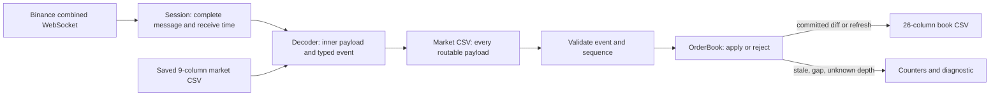

# Proposed design: Binance capture and local order book

Status: **Stage 4C market-data CSV implementation; validation recorded separately below**. Initial scope is Spot BTCUSDT, one symbol and connection, C++17/CMake, Asio/Beast/OpenSSL/nlohmann-json and ordered maps. The depth5/diff algorithm remains unimplemented and unverified; receiving the streams does not validate reconstruction. Live capture and both CSVs take priority over replay, USD-M and optimization. The deadline supplied by the user is October 22.

Inputs reviewed: [requirements.md](requirements.md) and all six pages of the original assignment, using the extraction reviewed against the rendered PDF in Stage 1. The requirements document is unchanged. Exchange and library references are linked beside the relevant claims. Recommendations below are project decisions, not extra requirements attributed to the PDF.

## A. Four essential concepts

1. **Diff versus snapshot.** A diff containing bid `(100, 3)` means set the quantity at price 100 to 3; other unmentioned levels remain unchanged. A `depth5` message supplies a replacement view of the best five bids and asks at its update ID. A missing price in a partial snapshot may have moved outside the five; it is not proof of deletion from the whole exchange book.
2. **Maintaining levels.** Bids sort highest first, asks lowest first. Starting with bid `100:2`, an update `100:5` replaces 2 with 5. Update `99:4` inserts a level if absent. Update `100:0` removes 100, making 99 the best bid if no better bid remains. Deleting an absent level is harmless.
3. **Sequences and reconnects.** If the modeled Spot state covers exchange update 100, a diff spanning `[101,103]` can advance it to 103. A diff ending at 99 is stale; one starting at 105 leaves update 104 uncovered. Our connection sequence counts received events; it cannot detect an exchange update missing before receipt. Reconnecting increments our connection epoch and invalidates the previous live book until it is refreshed.
4. **Fixed-point decimals.** With scale `100000000`, price string `"101.25"` becomes integer `10125000000`; quantity `"0.003"` becomes `300000`. Parse decimal characters directly with checked integer arithmetic. Binary floating-point conversions can introduce rounding into price keys or CSV integers, breaking exact comparisons and repeatable replay.

The sequence example explains Spot application logic; USD-M continuity uses an additional rule described below. The PDF requires correct diff/delete behavior, fixed scaling, documented recovery, and `depth5` replacement. It does not select our recovery algorithm or guarantee a full book from five levels.

## B. Recommended scope and its correctness boundary

Approved initial scope: **Spot BTCUSDT, one symbol per run, one combined WebSocket connection**, all three required subscriptions and both mandatory CSVs. Other instruments, offline replay and USD-M are deferred until working live capture and both outputs. Stage 4C adds the nine-column market CSV to Stage 4B reception; reconstruction and the book CSV remain later work.

Recommend a **limited top-five model anchored by fresh `depth5` snapshots**, with strict checks on how much of the price range is known. This is smaller than a REST snapshot/buffer/recovery implementation and makes replay self-contained from the nine-column audit CSV. It is not a full-depth synchronized order book.

**Material limitation under conditional approval:** an otherwise valid diff may expose an unknown sixth level. This proposal then invalidates the modeled view, emits no book row for that uncommitted diff, and waits for a sufficiently fresh `depth5`. Every successfully applied diff and snapshot would emit a row. All received routable events would still go into the audit. The PDF permits documented dropping until a snapshot, but does not explicitly approve this particular coverage-based drop policy. Conditional architecture approval is not proof of correctness or reviewer acceptance; deterministic tests and live validation are still required. If every contiguous diff must produce a continuously correct top five, select the larger REST-based alternative in section H.

Spot-only initial coverage is approved; USD-M remains deferred. The PDF contains both venue examples without explicitly saying whether both must be implemented. An unsupported `--venue usdm` fails clearly; it never silently selects Spot.

This proposal omits multishard capture, a writer thread, plugin interfaces, an abstract event bus, and performance-specific containers. These can be added only when requirements or measurements justify them.

## C. Libraries and build

| Concern | Recommendation | Reason and cost |
| --- | --- | --- |
| Language/toolchain | C++17, GCC 12, Linux reference build | Matches the PDF's example and keeps the required standard explicit. Windows/WSL may be used for development; Linux remains the submission validation target. |
| Networking | Boost.Asio plus Boost.Beast, Boost headers 1.74+ | Stage 4B uses the `Boost::headers` imported target. These versions provide header-only Boost.System; no unused compiled Boost library is required. Windows also links Winsock libraries. No hand-written framing. |
| TLS | OpenSSL 1.1.1+ through Asio SSL; supported OpenSSL 3 recommended | Stage 4B enforces certificate-chain and hostname verification, SNI and TLS 1.2+. OpenSSL default CA paths are used; `SSL_CERT_FILE` can select a trusted bundle for a portable installation. No insecure fallback. |
| JSON | nlohmann/json 3.10+ discovered as an installed CMake package | Package discovery avoids configure-time downloads. Stage 4C parses the envelope once with `ordered_json`, checks stream/object/supplied symbol, and minifies the inner object, retaining key order, unknown fields and decimal strings. Full book/event decoding remains unimplemented. |
| Build | CMake 3.16+, one application target and a focused envelope test executable; Ninja optional | Target-scoped C++17 and warnings, default Release, local dependencies, CTest for envelope/CLI checks. No generic build framework or configure-time download. |
| Tests | CTest plus a small C++ test executable with explicit checks and failure exit codes | Avoid another runtime dependency. Checks must remain active in Release; do not rely on disabled `assert` expressions. |
| CLI/logging/CSV | Small focused functions and standard streams | Few options and fixed schemas do not justify extra frameworks. CSV escaping and reading still require real quoted-field handling. |

The actual Windows build used GCC 16.2.0, CMake 4.4.4, Ninja 1.13.2, Boost 1.92.0, OpenSSL 3.6.5 and JSON 3.12.0 in an explicitly authorized isolated UCRT64 setup. No global settings were changed. These results do not establish Linux/GCC 12 compatibility; the portable CMake dependency discovery remains intended for that final check. JSON adds to the PDF's example dependencies. Exact commands and evidence are in [stage4b-validation.md](stage4b-validation.md).

Beast supports synchronous and asynchronous operations. Its built-in WebSocket timeout mechanism requires asynchronous I/O, which is one reason to choose a single asynchronous event loop here. See [Beast timeouts](https://www.boost.org/doc/libs/latest/libs/beast/doc/html/beast/using_websocket/timeouts.html). Asio's TLS layer uses OpenSSL and provides peer/hostname verification; see [Asio SSL](https://www.boost.org/doc/libs/latest/doc/html/boost_asio/overview/ssl.html). JSON supports a namespaced CMake target; see [nlohmann/json CMake integration](https://json.nlohmann.me/integration/cmake/). Dependency discovery uses standard [CMake package discovery](https://cmake.org/cmake/help/latest/command/find_package.html).

## D. Proposed files and responsibilities

This is a planned tree, not a scaffold created during this stage:

```text
binance-lob-capture/
  CMakeLists.txt
  README.md
  .gitignore
  docs/
    requirements.md
    design.md
  src/
    main.cpp
    config.hpp / config.cpp
    types.hpp
    decimal.hpp / decimal.cpp
    decoder.hpp / decoder.cpp
    order_book.hpp / order_book.cpp
    csv.hpp / csv.cpp
    session.hpp / session.cpp
    envelope.hpp / envelope.cpp  # inner payload extraction, not full book decoding
    market_data.hpp / market_data.cpp # implemented market CSV and metadata helpers
    replay.hpp / replay.cpp
  tests/
    tests.cpp
    fixtures/
```

| Module or type | Sole responsibility |
| --- | --- |
| `main` | Assemble ownership, choose live/replay, route one event through audit, book and output, print counters and exit status. This is the application coordinator; it need not become an extra class. |
| `Config` and validation functions | Parse venue, one-symbol list, output directory, duration and replay options; reject unsupported combinations before connecting. |
| Plain types in `types` | Timestamp, scaled price/quantity pair, event kind, depth event, event metadata, output row, counters and process outcome. Prefer ordinary structs and scoped enums, not inheritance. |
| `decimal` functions | Exact string-to-scaled-integer conversion and range/precision checks. No networking or JSON knowledge. |
| `decoder` functions | Validate envelope/stream identity, minify inner object, decode all needed fields and decimal pairs once. Return a complete validated event or an explicit error; never partially mutate the book. |
| `OrderBook` | Own sorted levels, coverage boundaries, model update IDs and readiness state. Apply or reject events deterministically. Return an outcome: emit row, stale/drop, or wait for snapshot. No clocks, file handles or sockets. |
| `MarketDataCsv` and metadata helpers | Implemented Stage 4C: own the one market file, exact header, RFC 4180 escaping, CRLF, write/flush/close checks, receive-time splitting, checked connection sequence. The future book writer is separate work; no two-file abstraction yet. |
| `Session` | Stage 4B owns one io_context, DNS/socket/TLS/WebSocket/read buffer, phase/duration/cleanup/report timers and signal handling. Capture receive time before envelope parsing, print one intact sample per stream and report counters. The stack-owned private class lives until handlers drain; `run_capture` is the small public entry point. Epoch tracking and reconnect are later work. |
| `envelope` functions | Stage 4C returns a `MarketEvent` with kind, configured symbol and owned minified inner JSON. Reject malformed/unexpected envelopes and mismatching supplied symbols; identify server notices without emitting market rows. Do not decode order-book fields. |
| `replay` functions | Read saved market CSV with quoted-field support, reconstruct event metadata and use the same decoder/book/row-formatting path without creating a Session. |

Ownership is RAII: files and sockets are owned objects whose destructors release resources. The coordinator and Session stay alive until outstanding handlers finish or are cancelled and drained. Buffers/JSON trees are never referenced after reuse; decoded events own the small data they retain. No worker queue stores references into the read buffer.

## E. Structures, complexity and trade-offs

Store integer price-to-quantity levels in two ordered maps: descending comparator for bids and ascending comparator for asks. `begin()` is the best known level. Store all levels inside the current certified price ranges, including a level that temporarily falls to sixth or lower after better levels are inserted. Do not erase such a level merely because only five are exported.

Use a reusable vector of decoded update pairs for each side. Use fixed-size arrays of five price/quantity pairs for each exported snapshot. A map may contain more than five known levels; the CSV always has five slots per side.

For `k` updates and `N` retained levels, map changes cost `O(k log N)` and top-five extraction costs `O(5)` per side; a five-level reset is bounded work plus clearing old nodes. Memory is `O(N + k)`. Insertions allocate; quantity replacements normally do not.

| Alternative | Advantage | Why not the initial choice |
| --- | --- | --- |
| `std::unordered_map` | Average constant-time lookup/update | Does not keep price order; finding the best five requires a scan or an additional ordered structure. |
| Sorted vector | Compact storage and cache locality | Inserting/removing levels can move `O(N)` elements. Reasonable future option if retained books are measured small. |
| Only two arrays of five | Very simple and bounded update work | Loses a known sixth level when new better prices arrive, and cannot manufacture a previously unknown sixth after deletion. |
| Full-depth map | Can retain much deeper context | Needs a suitable initial snapshot; a map alone does not create knowledge of unseen levels. |

The PDF explicitly prefers `O(updates)` top-five work and asks candidates to explain map trade-offs. This proposal's honest bound is `O(k log N)`, not `O(k)`. Ordered maps prioritize correctness and reviewability; that performance preference is a review trade-off requiring acknowledgment, not a satisfied asymptotic claim. Avoid copying the whole map per message; validate the payload first, update it, and either commit the complete valid view or clear it on coverage loss.

## F. Complete event flow



1. Finish a WebSocket message read; capture wall-clock time immediately, before JSON processing. Assign the connection-local sequence for that completed text message.
2. Parse the envelope once. Classify by the exact stream suffix; a symbol in the payload must agree with its stream. Minify the inner `data` object while preserving decimal strings and unknown fields.
3. For a recognized subscription with an object payload, write its nine-column market row **before any book mutation**, including stale events and semantically invalid payloads. Complete parsing/validation results can already be known, but audit placement precedes state mutation. A file error stops processing; never update the book after losing its audit record.
4. Check field types, decimal range, duplicate price entries, sequence consistency and the model policy. Decode/validate the whole event before modifying the book. An unrecoverable payload error stops the run after the audit row, leaving the earlier book output as a reproducible prefix.
5. A trade is audited and counted, with no book mutation and no book row. A depth event enters OrderBook. A successfully committed event produces exactly one book row, even if its displayed five did not change.
6. Use that event's original receive timestamp for the book row; increment book `seqNo` only for an emitted row. No sorting by `E`, `T`, price-update ID, or local clock happens outside the explicitly documented sequence checks.
7. Format each row completely, write it through the corresponding buffered file, and then release/reuse per-message storage. Continue the read loop without an unbounded application queue.

The audit represents receive/consumer order, not guaranteed total exchange chronology across subscriptions. A single connection does not make its three streams a transactionally synchronized bundle.

## G. Proposed limited-book algorithm

### G1. What the model knows

The ready state stores:

- `L`: exchange update ID of the last committed modeled state.
- `H`: highest exchange depth ID observed from a valid depth message in this connection epoch, including a diff rejected for a gap or insufficient coverage.
- `last_published_id`: exchange ID of the last exported state, retained during a recovery wait.
- `bid_floor`: fifth bid price in the last accepted complete depth5 anchor.
- `ask_ceiling`: fifth ask price in that anchor.
- All currently positive levels at bids `>= bid_floor` and asks `<= ask_ceiling`, not only the five exported slots.

Those price intervals are complete in the anchor's visible book if the proposed anchor/sequence assumptions hold: any better price would have appeared ahead of its fifth level. Continuous absolute updates would preserve knowledge inside those intervals. They tell us nothing about unchanged prices outside them. The proposed algorithm ignores outside-range diff pairs for storage, but still validates every pair and advances sequence when the event is committed. This remains a design argument, not a tested implementation claim.

We can export a complete top five after a diff only while both intervals contain at least five positive known levels. The proof depends on receiving a coherent depth5 anchor and all required subsequent diff coverage. This is a project invariant, not an extra Binance promise about cross-stream delivery order.

**Prerequisite to validate:** Spot `lastUpdateId` and diff `U/u` must describe comparable revisions of the same symbol's visible book. Official Spot schemas expose those update identifiers, but do not promise a global arrival ordering across the two streams. Treat cross-stream comparison as an explicit integration assumption to verify with recorded fixtures and a live comparison. If the ID semantics cannot be established, this merge model is not approved as correct; select separate diagnostic views or redesign around documented REST synchronization rather than timestamp guessing.

### G2. Snapshot replacement

For Spot `depth5`, use `S = lastUpdateId`:

1. Validate positive unique prices, positive snapshot quantities, at most five levels per side, correct ordering, and an uncrossed visible book. Never sort away conflicting duplicate entries or silently repair malformed data.
2. Require `S >= max(H, last_published_id)` for a refresh. Lower IDs are stale relative to already seen/committed depth information: audit and count, without changing the book or emitting a row. Reset epoch-local IDs after a reconnect; do not compare revisions from different epochs as if continuity were known.
3. If `S == L` and there is a ready book, compare the snapshot to its extracted top five. A contradiction is a fatal consistency error, not permission to overwrite newer quantities. A matching equal-ID snapshot is an applied refresh and emits one `P` row, even if unchanged.
4. For an accepted snapshot, replace both maps from the supplied levels together, reset coverage boundaries, set `L = S`, update `H`, and emit one `P` row. Discard previous deeper knowledge deliberately; never overlay old levels into this replacement.
5. If both sides have five levels, enter `READY`. If either supplies fewer, emit the supplied snapshot with zero-padded unused slots and remain `WAIT_SNAPSHOT`: do not claim enough range information for later diff-based top-five reconstruction. A short snapshot is a representation of that payload, not an invented sixth level.

Using `H` is conservative: while waiting, a snapshot behind a newer already seen diff is not used to rewind or partially replay discarded history. This can delay recovery; it is a simplicity trade-off, not an exchange guarantee that the next snapshot will be fresh enough.

### G3. Spot differential updates

Validate `U <= u`. Advance `H` with valid event `u` even if the event will be dropped. Then:

| Condition | Decision |
| --- | --- |
| Not `READY` | Audit/count/drop the diff; await a qualifying snapshot. No buffer in this model. |
| `u <= L` | Already covered/stale: do not apply and do not emit. |
| `u > L` and `U > L + 1` | Uncovered sequence gap: invalidate maps, keep recovery watermarks and wait. |
| `u > L` and `U <= L + 1 <= u` | Event covers the next required revision; apply all in-range pairs by setting absolute quantities or erasing zeros. |

After a candidate update, both known ranges must still have at least five levels and best bid must be below best ask. Otherwise clear the candidate state, enter `WAIT_SNAPSHOT`, and emit no row for that uncommitted event. Do not emit the old book with the new event's metadata. A consistent candidate commits `L = u`, emits one `D` row, and advances `last_published_id`.

Do not require every next `U` to be exactly `L+1` after a snapshot: a diff batch can overlap the snapshot revision. Covered earlier updates are harmless because pairs contain resulting quantities. Do not reorder future diffs to fill a gap; resnapshot instead. Duplicate/stale diffs do not generate duplicate book rows.

This proposal deliberately treats `u == L` as already covered. The current Spot guide uses a strict-less-than stale condition in its general live procedure and uses `<=` when dropping snapshot-covered buffered events; our duplicate suppression is an explicit conservative application policy.

### G4. Numerical examples

Start from snapshot `S=100`:

```text
Bids: 100:2, 99:5, 98:4, 97:6, 96:8   bid_floor = 96
Asks: 101:3, 102:4, 103:2, 104:5, 105:6   ask_ceiling = 105
```

| Received event | Result |
| --- | --- |
| Diff `[101,102]`: bid `99:7` | Commit quantity 7, set `L=102`, emit `D`. |
| Snapshot `S=101`, with older `99:5` | Stale: audit only. Never overwrite 7 with 5. |
| Snapshot `S=102`, matching current top five | Replace/refresh both sides and emit `P`. |
| Diff `[103,103]`: insert bid `100.5:1` | Six known bid levels inside the original range; export the best five, but retain known price 96. |
| Diff `[104,104]`: delete bid `98:0` | Five known bids remain; retained 96 can return to the top five. Emit `D`. |
| Duplicate diff ending at 104 | Audit only. |
| Diff `[106,107]` while `L=104` | Missing revision 105: invalidate; `H=107`; wait for snapshot at least 107. |

Separate unknown-sixth example: immediately after the original five-level anchor, a contiguous diff deletes bid 96. Only four bids remain inside the known range. Even if it also introduces a known bid at 94, an unchanged unseen bid at 95 could be better. **Never promote 94 as the guaranteed fifth.** Discard the candidate modeled update, wait, and replace from a sufficiently fresh snapshot. A fresh snapshot at 105 can also jump forward over older diff batches: once accepted, a later-arriving diff ending at 104 is covered and ignored.

### G5. What is required, guaranteed, or proposed

| Category | Statement |
| --- | --- |
| PDF requirement | Correct quantities/deletion, best-first top five, applied-event rows, depth5 replacement, documented gaps/epochs. |
| Binance semantics | Spot diff pairs set quantities; partial depth carries top levels and a last update ID; documented full synchronization uses a REST snapshot plus buffered diffs. |
| Proposed integration policy | Fresh snapshot replaces both sides; no timestamp-based merging; stale/covered events stay audit-only; loss of proven coverage pauses diff output. |
| Not claimed | Complete exchange depth, continuous output through unknown depth, identical Spot/USD-M rules, or unconditional assignment acceptance of this limited model. |

The [official Spot reference](https://github.com/binance/binance-spot-api-docs/blob/master/web-socket-streams.md) is authoritative for payload and synchronization semantics. This limited projection and coverage proof are our proposed algorithm, not Binance's documented full reconstruction recipe.

## H. Full synchronization alternative and USD-M distinction

If stronger depth continuity is approved, add a REST snapshot client and bounded diff buffer. Receive and buffer diffs while retrieving a snapshot; bridge its update ID with buffered events, then follow the venue's continuity rules. Keep known deeper levels and track the snapshot's coverage boundary: even a finite REST snapshot is not knowledge of unlimited exchange depth. Persist every REST response and the exact processing position where it is installed, plus relevant reset decisions, if offline replay is promised. The market CSV must retain its exact nine-column contract; initialization goes in a documented companion journal rather than disguised Binance WebSocket rows.

For **Spot**, the current official procedure buffers before REST, discards snapshot-covered events and checks that subsequent events cover the next required revision; a gap restarts synchronization. There is no Spot `pu` field to invent. The guide's startup wording and next-revision interval check should be translated into boundary tests before implementing the REST option. For **USD-M**, the official procedure discards buffered events with `u < snapshot ID`, starts with `U <= snapshot ID <= u`, and requires each subsequent event's `pu` to equal the preceding event's `u`. Example: previous `u=203`, next `pu=203` is linked; `pu=205` is not. These rules are not interchangeable. See [USD-M reconstruction](https://developers.binance.com/docs/derivatives/usds-margined-futures/websocket-market-streams/How-to-manage-a-local-order-book-correctly).

This is an alternative scope, not an approved second mode to build now. It introduces HTTP, buffering, reset journaling and an additional policy for depth5 interaction. A conservative full-mode approach keeps REST/diff state authoritative and uses depth5 as a version-matched sanity/refresh input, never blindly replacing a deeper map with five levels. How ahead-of-diff depth5 messages are queued or discarded, and how applied refresh rows preserve processing order, must be specified before that mode can be claimed correct. Do not quietly bolt it onto this proposal.

If USD-M is requested, separately verify current raw `@trade` availability/path and payloads as well as `depth5` differences against the official docs and live fixtures. The PDF's `/public` example is a source requirement reference, not evidence from a successful capture. Do not substitute `aggTrade` for required `trade` without explicit agreement.

## I. Exact output and numeric policies

All policies in this section are proposed decisions needing approval, not changes to the PDF contracts.

| Topic | Proposed policy |
| --- | --- |
| Timestamp | Capture `system_clock` immediately on completed message receipt; split integer nanoseconds into seconds/remainder. Both CSV rows for an applied event use exactly that stored timestamp. No replacement with `E/T`. |
| Duration/backoff | Use `steady_clock`, independent of wall-clock adjustments. `--duration 300` means 300 seconds from starting live connection attempts, including outages; default is until signal. |
| Processing order | Completed-message order on the one connection. Equal/backward timestamps are allowed; never reorder the tape by timestamps. |
| Decimal factors | Price and quantity both use `100000000` for this scope, satisfying even the stricter reading of “same scaling.” Store prices/sizes as `int64_t`. |
| Decimal grammar | Non-negative plain decimal strings only; positive prices, quantities may be zero. Permit additional fractional digits only when all beyond the eighth are zero. Reject nonzero excess precision, signs, exponents and overflow; no rounding or `double` intermediate. Check multiply/add operations before executing them. |
| Exchange IDs | Parse/check as non-negative `uint64_t` values; check `L+1` before adding. Validate `U <= u`. Never use IDs as timestamps. |
| `shard_id` | Always 0 for the proposed one-connection scope. |
| `conn_epoch` | Initial connected epoch 0; increase for each new established connection after the first. Repeated failed handshake attempts are counted separately and do not masquerade as received-message epochs. |
| `conn_seq` | Start at 1 per epoch, increment for each completed text message before routing; control/error messages may therefore leave visible audit gaps. A replay gap in `conn_seq` alone is not proof of a lost market event. |
| `seqNo` | `uint64_t`, start at 1 and increment once per emitted book row; never reset on reconnect during a run. Stop on overflow. |
| Instrument ID | `id=1` for the single supported instrument in the session; the audit/CLI identify which instrument. Multi-symbol ID derivation is deferred. |
| Event letters | `D` for committed depth diff, `P` for applied depth5 refresh. No trade book rows. |
| Side | `B` for a diff with bid pairs only, `S` for ask pairs only, `N` for both/neither and for all depth5 replacements. Classification uses validated event sides, even if an update is outside stored coverage. |
| Missing slots | Pad unused positions of a short depth5 payload with price 0 and size 0. Reserve zero price for unused slots; do not store a live zero-price/zero-size level. Never use padding to conceal an unknown sixth level after a diff. |
| File lifecycle | Date-pattern filenames, UTC run-start date, one pair per run in the chosen output directory. Keep the same pair over midnight as a documented per-run convention. Refuse existing target files; no append or implicit overwrite. |
| Encoding/escaping | UTF-8; comma-separated; quote fields containing comma/quote/CR/LF and double internal quotes. Use CRLF row endings consistently and locale-independent integer formatting without grouping separators. JSON remains a single minified line with string escapes. |
| Buffering | Stage 4C formats one complete row and uses buffered `FILE` writes. Flush the header at creation, then schedule a flush every second and check flush/close after handlers drain. A blocked event loop can delay that timer. No per-row flush. Per-row strings still allocate; reuse/pooling is deferred. The future book writer should share the flush schedule. |
| I/O errors | Stop on write/flush/open failure with nonzero status; never continue producing unaudited book rows. Across two files there is no transactional crash guarantee. A failed run may have a longer audit prefix than book prefix. |

The fixed scales are suitable only for supported values that fit their precision/range. Wider precision or per-symbol scales are a change to the policy, not silent rounding. Unexpected precision stops with a diagnostic instead of corrupting keys.

Exact headers copied/reconstructed as disclosed in requirements.md:

```csv
recv_tsec,recv_tnsec,venue,stream_kind,shard_id,conn_epoch,conn_seq,symbol,payload_json
```

```csv
tsec,tnsec,seqNo,id,type,side,bid0,bid1,bid2,bid3,bid4,bid_size0,bid_size1,bid_size2,bid_size3,bid_size4,ask0,ask1,ask2,ask3,ask4,ask_size0,ask_size1,ask_size2,ask_size3,ask_size4
```

In an interview: `conn_seq` orders our received messages; `conn_epoch` separates connection generations; `seqNo` counts our emitted snapshots; `U/u` identify exchange book revisions. None can replace another.

## J. Reliability, shutdown and bounds

| Situation | Proposed behavior |
| --- | --- |
| DNS/connect/network/WebSocket failure | Clear readiness immediately, retain already written output, retry with capped exponential backoff of 1, 2, 4, 8, 16, then 30 seconds. Reset the retry delay after a connection has been healthy for 30 seconds. |
| New connected epoch | Clear book, coverage and exchange-ID state; begin audit sequence at 1; wait for fresh depth5. Keep application `seqNo` and file handles. Replay performs the same reset when epoch changes. |
| Sequence gap or lost depth coverage | Deterministic transition to `WAIT_SNAPSHOT`; no need to reconnect just to obtain the already subscribed partial snapshot. Keep auditing trades/diffs and count dropped book candidates. |
| Valid envelope, invalid event fields | Audit the object, log the reason, stop the run. This strict initial policy avoids hidden reset behavior that cannot be recovered from the audit. A future continue-on-error policy requires tests and replayable reset rules. |
| Unparseable JSON, wrong envelope, unexpected symbol/stream | Log/count and stop without fabricating an inner payload row. Such bytes cannot satisfy the required JSON column contract. Previously completed rows remain a prefix. |
| Ping/pong and fragments | Let Beast assemble full messages and handle protocol control frames under its supported read flow; control frames are not market CSV events. Observe the venue's heartbeat requirements. |
| Server shutdown/control notice | Do not invent a depth/trade payload. Trigger orderly reconnect; the next epoch resets book correctness. A reconnect request that fails does not generate fake market rows. |
| TLS verification failure | Fatal diagnostic; do not disable verification or endlessly retry an invalid trust configuration. |
| Disk error or allocation failure | Fatal; report nonzero status and partial-output limitation. |
| SIGINT, SIGTERM, or duration expiry | Finish the current already-read event; stop scheduling market reads/retries, coordinate WebSocket close with outstanding operations, then TLS/socket teardown and flush/check files. Bound shutdown waiting to five seconds; force-close the socket if needed. Keep owners alive until cancellation handlers finish. |

Proposed limits, not Binance-prescribed constants: one symbol, one shard, three subscription streams, maximum URL length 2048 bytes, complete message size 1 MiB, at most 10000 update pairs per side, and at most 20000 retained levels per side. A bound violation is fatal and logged, not silent truncation. Configure connection/handshake deadlines and WebSocket idle timeout; proposed handshake limit is 15 seconds and idle timeout 60 seconds. Use the appropriate timeout mechanism for the current connection phase.

Shutdown is orderly at normal storage speeds. A blocking filesystem call can delay a one-thread event loop; the five-second network-close deadline cannot preempt a kernel write that is already blocked. Do not claim hard real-time shutdown or crash-safe persistence.

Counters: text messages, audited market rows, decoded kinds, committed diff rows, applied snapshot rows, stale diffs/snapshots, gaps, coverage losses, waits/drops, parse/schema errors, reconnects/failed attempts, I/O errors, and shutdown reason. Print start configuration and final counters to stderr; do not add columns to either CSV.

**Current Stage 4C subset:** the recovery/resynchronization table above remains the later book design. The client stops with exit 1 on DNS/connect/handshake/read/envelope or CSV failure; it does not reconnect or resynchronize. Market rows use fixed shard 0 and epoch 0. Every completed text message consumes a checked uint64 sequence starting at 1; server notices consume a sequence but produce no market row and stop the run. Binary data is fatal. Exit 0 requires an intentional duration/signal stop after observing all three streams and successful CSV finalization. Only complete messages processed before the stop are counted. SIGINT/SIGTERM and Windows SIGBREAK share the shutdown path; cleanup has a five-second limit. Beast performs WebSocket/TLS teardown. If the peer returns normal WebSocket close code 1000 but omits TLS close_notify during intentional shutdown, report a separate warning. Do not suppress truncation during a live read or accept an unconfirmed close. This narrow cleanup policy was selected after an actual Binance run exhibited that behavior.

`run_capture` owns `MarketDataCsv` longer than Session. The CSV opens before networking and may remain header-only after setup failure. Directory creation is allowed; existing CSVs are atomically refused using `_wopen`/`open` with exclusive creation. The descriptor becomes a buffered binary `FILE`; no platform networking code changes or global environment changes are needed. Explicit checked close follows callback drainage; the destructor provides fallback cleanup. No append, midnight rotation or automatic retry with a different filename. Use another output directory for a second run on the same UTC date. Serialization retains string values and JSON values, not the outer envelope's whitespace or original numeric spelling. No price/quantity conversion occurs.

## K. One-thread execution and replay

One thread runs one Asio `io_context`. DNS/connect/handshakes/reads/timers/signals are asynchronous; decoding, ordered-map updates and buffered file writes execute sequentially in their handlers. No book mutex, worker pool, lock-free queue or parallel JSON parsing is needed.

Asynchronous does not mean multithreaded: a read can wait while the same event loop handles a timer, but handlers execute one at a time. This gives a clear event order and straightforward ownership. It also means expensive parsing or slow writes delay networking, heartbeat handling and shutdown. Bound inputs, avoid per-row flushes, measure the short sample, and use the gap/reconnect rules if overload breaks continuity. Do not silently discard incoming messages to claim throughput. A dedicated writer with a bounded queue is a later measured optimization, not this initial scope.

Replay is a separate execution path with no Session, DNS, TLS context, REST client or timers that contact Binance. It reads the saved nine-column CSV in physical row order, validates the contract, reuses stored receive timestamps and metadata, and calls the same decoder, OrderBook and row formatter. On epoch change reset exactly as live does. Do not sleep to reproduce live timing and do not stamp replay rows with the current time.

For this fixed-policy one-symbol model, the CSV contains the needed instrument, timestamps, epochs and payloads; no initialization sidecar is required. README identifies a fixed policy version, scale, ID and type mapping. Replaying a file produced under a different policy is not promised equivalent. An input with decreasing epochs, duplicate/backward connection sequences, wrong symbol or malformed CSV is rejected. Sequence gaps alone are allowed because nonmarket messages may have consumed local sequence numbers.

Determinism target: same complete audit tape + same policy version yields byte-identical book CSV (including headers and row endings). Rejected events and recovery decisions depend on tape contents and bounds, not current clocks or random choices. A fatal captured semantic error is reproduced at the same row and leaves the same earlier book prefix. Malformed raw frames not representable in the audit stop live processing and cannot cause later unrecorded book changes. Audit-derived counters can agree across live and replay; transport-only counts, such as failed handshakes or nonmarket control messages, cannot be reconstructed from this CSV and must not be claimed identical.

## L. Tests and implementation order

The table below is the remaining implementation/test plan; it is not a claim that future book tests were run. Historical Stage 4B checks are in [stage4b-validation.md](stage4b-validation.md). Stage 4C CSV and live validation are recorded in [stage4c-validation.md](stage4c-validation.md); the market CSV subset of the plan is now implemented.

| Order | Implement after approval | Important checks before moving on |
| --- | --- | --- |
| 1 | Numeric types and decimal conversion | Exact padding, equivalent decimals, zero deletion value, nonzero excess precision, trailing extra zeros, rejected syntax, checked overflow at boundaries. |
| 2 | CSV formatting and reading | Exact 9/26 headers/counts, JSON commas/quotes/escaped newline, UTF-8, CRLF, no field truncation, missing-slot zero pairs, read/write failures. Use an independent CSV parser/checker in validation where available. |
| 3 | Decoder and plain events | All three Spot payloads; symbol comes from depth5 stream name; complete validation before mutation; bad types, IDs and duplicate prices; unknown fields survive audit minification. |
| 4 | OrderBook and coverage states | Replace quantity, insert, delete, absent deletion, bid/ask ordering, multi-side events, stale/duplicate IDs, equal-ID snapshot consistency, overlapping batch acceptance, sequence gaps, epoch reset, coverage-loss pause, retained known sixth versus unknown sixth. |
| 5 | Live coordinator | Hand-authored event fixture with expected full book rows and audit-derived counters; audit-only trades/stale/dropped events; stored timestamps even when nonmonotonic. |
| 6 | Asio/Beast Session | TLS verification failure, complete-message fragmentation, ping/pong, disconnect/reconnect, stalled connection, retry timing, SIGINT/SIGTERM and duration stop without dangling callbacks. Use a local test peer for injected failures rather than hoping Binance produces them. |
| 7 | Real sample and review evidence | Clean Linux build with warnings, 1–2 minute paired sample, reviewer 300-second invocation, all-row schema checks, audit/drop/error counters, sanitizer build for ownership paths. No performance or compiler-test claims without evidence. |
| 8 | Offline replay after working live capture and both CSVs | CSV reader, shared processing path and byte-identical book comparison; replay makes no network calls. This is explicitly lower priority under conditional approval. |

For the limited-model acceptance test, use a test-only deeper reference book to derive depth5 anchors and diffs, then compare every emitted top five against the reference. Explicitly include a case where an unseen sixth remains unchanged. Verify that output pauses rather than guessing. This is more meaningful than testing the implementation against itself.

Live consistency checks cannot establish every missing guarantee of an exchange protocol, but they can falsify incorrect assumptions. Validate cross-stream ID comparisons and measure how often the conservative recovery policy suppresses rows. If refreshes never qualify or gaps/coverage losses dominate, treat that as a failed design validation and revisit scope, not a successful capture.

## M. Decisions needing approval and remaining questions

| Decision | Recommendation | Approval / evidence still needed |
| --- | --- | --- |
| Venue and symbol scope | Spot BTCUSDT; one symbol and connection | Approved initial scope; USD-M and other symbols deferred. |
| Book correctness scope | Limited top-five model with proven-range checks and snapshot recovery | User approval of paused output and application interpretation; validate cross-stream revision semantics. Full REST mode is the alternative, not silently included work. |
| Libraries and threading | Asio/Beast + OpenSSL + nlohmann/json; one async event-loop thread | Windows Release build and live reception verified with the isolated packages. Final Linux/GCC 12 build remains unverified. |
| Complexity | Ordered maps, `O(k log N)` | Maps approved for the initial implementation; logarithmic trade-off remains explicit. |
| Output policy | Receive timestamps, identical price/size scale 1e8, ID 1, D/P, no trade book rows, documented zero padding | User approval; precision compatibility for selected symbol. |
| Recovery and malformed data | Reconnect resets; gap/unknown depth waits; malformed data stops with a reproducible prefix | User approval of strict failure behavior and diagnostics. |
| Replay | Defer until live capture and both CSVs work | User-directed priority change; not implemented. |
| Files and duration | Refuse existing outputs; one pair per run; UTC start date; reviewer duration flag | User approval of lifecycle convention. |
| Short snapshots | Output exact supplied levels with zero padding; wait before diff reconstruction | Validate expected behavior if the chosen symbol genuinely has fewer than five visible levels. |

Interview explanation: the book is a deterministic function of ordered input. A snapshot establishes what prices are known, diffs update quantities only where continuity is established, and lost information triggers recovery instead of guessed output. Networking and file ownership remain separate from that state transition logic. Ordered maps make the ordering and deletion rules easy to inspect; their logarithmic cost is acknowledged.

**Stage 4C boundary:** secure reception, inner JSON extraction, receive timestamps, connection sequence, samples/counters, buffered market CSV and shutdown are implemented. The validation record distinguishes actual Windows checks from remaining Linux verification. The existing isolated toolchain is reused; CMake downloads nothing. Decimal conversion, full book-field decoding, reconstruction, the book CSV, replay and reconnect/resynchronization remain unimplemented. Stage 4D requires further approval. The earlier request for `docs/concepts.md` remains deferred until the agreed concept coverage is completed or the user approves this combined document as its replacement.
